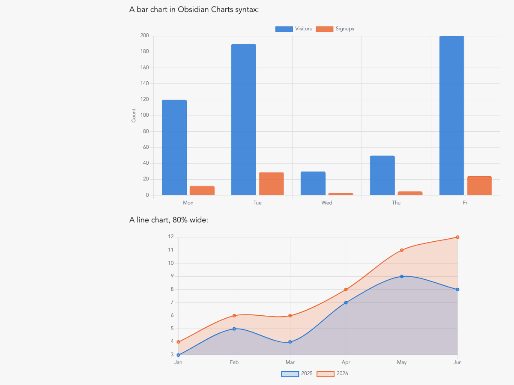

# Charts

A [Digital Garden](https://github.com/oleeskild/digitalgarden) plugin that
renders charts with [Chart.js](https://www.chartjs.org/). It understands the
`chart` code blocks from the
[Obsidian Charts](https://github.com/phibr0/obsidian-charts) plugin, so charts
you write in Obsidian show up the same way in your garden, and it also accepts
raw Chart.js configurations in `chartjs` blocks.



Charts follow your garden's theme: text, grid and series colors adapt to light
and dark mode. Chart.js 4 is bundled with the plugin and only loaded on pages
that contain a chart.

## Obsidian Charts syntax

````markdown
```chart
type: bar
labels: [Mon, Tue, Wed, Thu, Fri]
series:
  - title: Visitors
    data: [120, 190, 30, 50, 200]
  - title: Signups
    data: [12, 29, 3, 5, 24]
beginAtZero: true
yTitle: Count
width: 80%
```
````

| Key | Description |
| --- | --- |
| `type` | `bar`, `line`, `pie`, `doughnut`, `radar`, `polarArea`, `scatter`, `bubble` (default `bar`) |
| `labels` | Category labels |
| `series` | List of `{ title, data }`. Any extra keys on a series item are passed straight to the Chart.js dataset (for example `backgroundColor`, `borderDash`, `type`) |
| `width`, `height` | CSS size of the chart, e.g. `80%` or `300px` |
| `beginAtZero`, `stacked`, `indexAxis`, `spanGaps`, `tension`, `fill` | Same meaning as in Obsidian Charts |
| `xTitle`, `yTitle`, `xMin`, `xMax`, `yMin`, `yMax`, `xReverse`, `yReverse`, `xDisplay`, `yDisplay`, `xTickDisplay`, `yTickDisplay`, `xTickPadding`, `yTickPadding` | Axis options |
| `legend`, `legendPosition` | Show the legend (default `true`) and where (`top`, `bottom`, `left`, `right`) |
| `labelColors` | Color each data point instead of each series |
| `transparency` | Fill opacity, `0`–`1` |
| `textColor`, `padding` | Override label color and chart padding |

Not supported: `id` (charts built from a markdown table), `bestFit` (regression
lines), `time` axes, and sankey charts. A block using one of these still
renders, the key is just ignored with a warning in the build log.

## Raw Chart.js syntax

Anything Chart.js accepts, as JSON or YAML, with an optional `width`/`height`:

````markdown
```chartjs
{
  "type": "radar",
  "data": {
    "labels": ["Speed", "Power", "Range", "Defense"],
    "datasets": [{ "label": "Hero", "data": [4, 3, 5, 2] }]
  },
  "options": { "scales": { "r": { "beginAtZero": true } } },
  "width": "60%"
}
```
````

Datasets without explicit colors get the theme palette.

## Settings

| Setting | Default | Description |
| --- | --- | --- |
| Series colors | _(empty)_ | Comma-separated hex colors used for series in order, e.g. `#2a78d6,#eb6834`. Empty means the built-in palette, which has separate light and dark variants. |

The setting can also be set via `CHARTJS_PALETTE` in the garden's `.env`.

## Errors

A block that cannot be parsed is rendered as a plain code block, so a typo in
one chart never breaks the build. The reason is printed in the build log,
prefixed with `[chartjs]`.

## Install

Paste this repo's URL into the plugin installer of your garden, or copy the
plugin directory into `src/plugins/chartjs/` manually.

## Development

The YAML-to-config converter has tests that run with Node's built-in runner.
Point `NODE_PATH` at a garden checkout so the `yaml` package resolves:

```sh
NODE_PATH=../digitalgarden/node_modules node --test test/convert.node-test.js
```

Chart.js is vendored in `assets/chart.umd.js` (MIT, see
`assets/chart.umd.LICENSE.md`).
